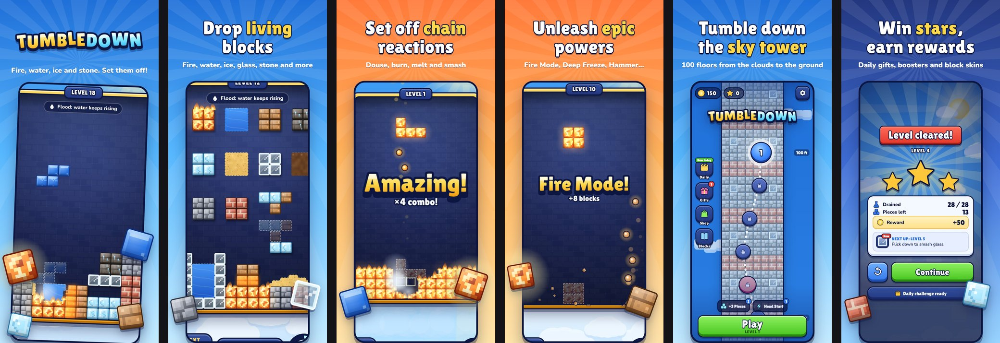

# Tumbledown

Fire, water, ice and stone: a falling-block puzzle where every piece is a material with its own physics. Put materials next to what cancels them, set off chain reactions, fill the goal before your pieces run out, and climb down a 100-floor tower from the clouds to the ground.

<p align="center"></p>

Play it: https://joudrie.github.io/teris/ (the live site updates when this branch is deployed)

```sh
npm start        # serves on http://localhost:8000
npm test         # rules, session, edge cases and every mechanic test card
```

- **The redesign:** audit, directions, design system, game feel, decisions and before/after comparisons are in [docs/redesign/](docs/redesign/). Start with [AUDIT.md](docs/redesign/AUDIT.md) and [SIMILARITY.md](docs/redesign/SIMILARITY.md).
- **Rules, test cards, win rates, the bug log and how to re-run every check:** [DESIGN.md](DESIGN.md).
- **Credits and licenses:** [docs/CREDITS.md](docs/CREDITS.md).

The code name stays `material-blocks` and saves use the same `mb_*` keys, so existing progress carries over.
