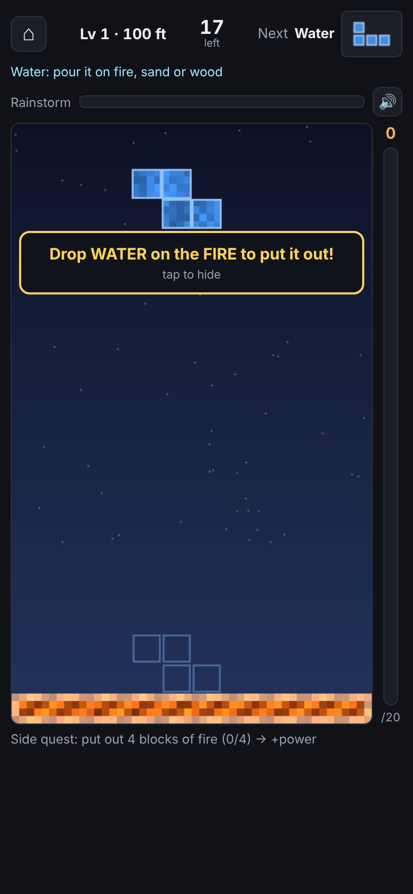
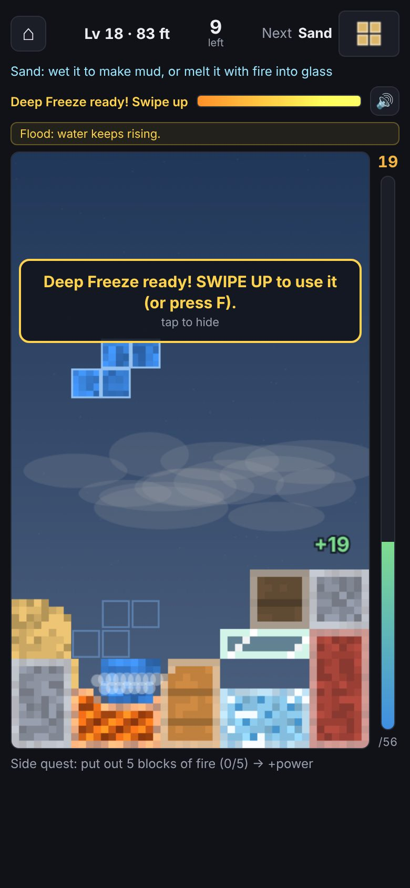
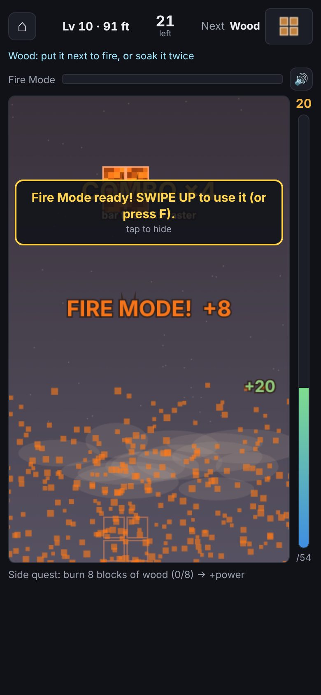
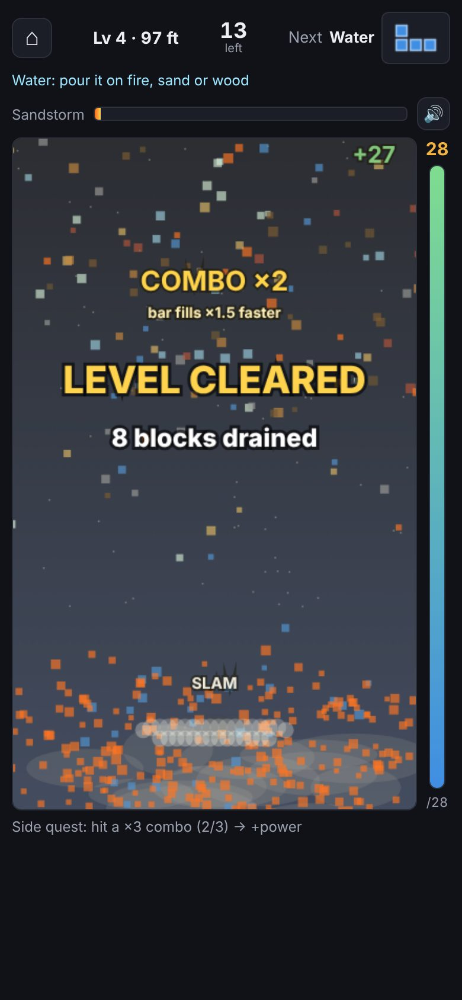
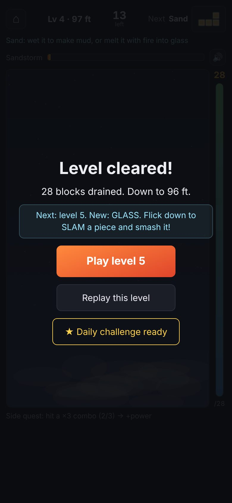
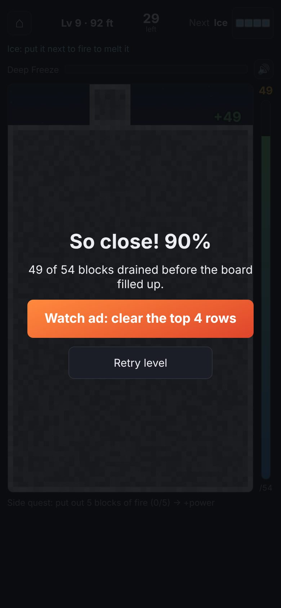
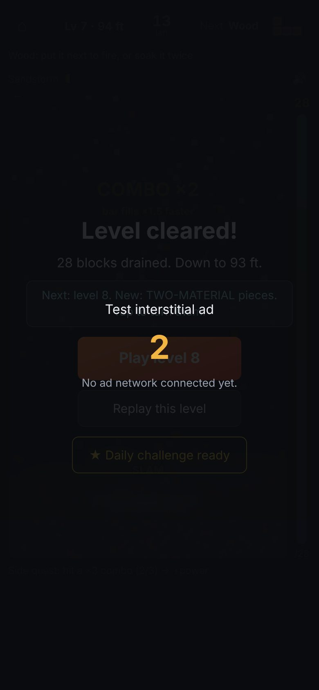
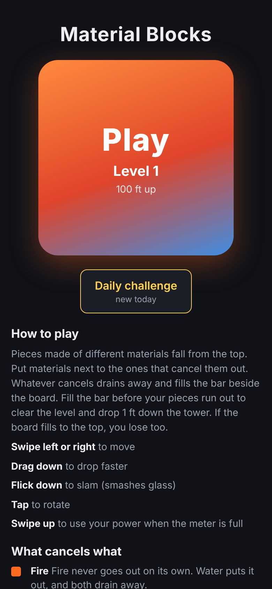
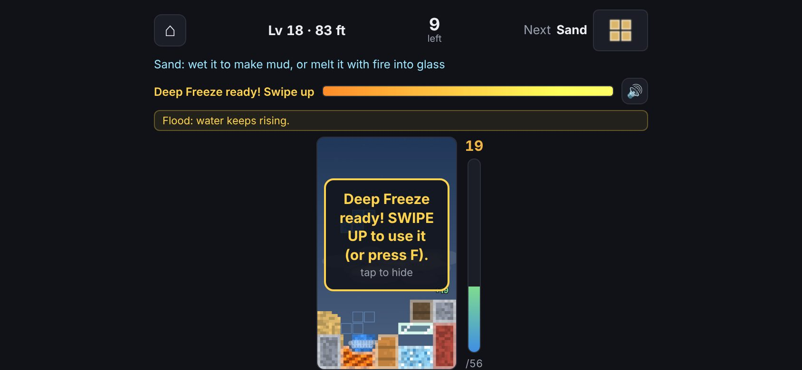
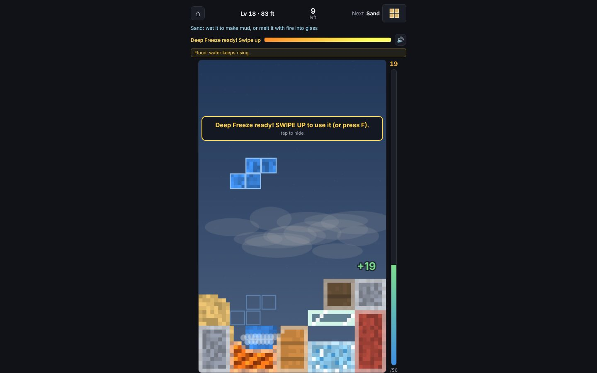

# Prototype audit

Every screenshot here is in [`before/`](before/) and was taken by `node tools/browser/shoot.mjs docs/redesign/before --sizes=all --video` on the prototype at commit `2082e54` (the bug-fix session's latest).

Scores are 1–10 **against the reference games** (Royal Match, Candy Crush Saga, Block Blast!, the official Tetris app), not against "fine for a prototype". Measurements are CSS pixels, taken in Chromium with `getBoundingClientRect`.

Rubric columns: **1s** one-second read · **Type** typography · **Col** color · **Bg** background · **Blk** blocks and materials · **Lay** layout and hierarchy · **HUD** · **Mot** motion and juice · **Copy** · **Snd** sound · **Val** brand and perceived value · **Mon** monetization surfaces.

## Summary scores

| Screen | 1s | Type | Col | Bg | Blk | Lay | HUD | Mot | Copy | Snd | Val | Mon |
|---|---|---|---|---|---|---|---|---|---|---|---|---|
| Gameplay, first second | 3 | 2 | 3 | 2 | 3 | 3 | 2 | 2 | 3 | 2 | 2 | – |
| Gameplay, busy board | 4 | 2 | 4 | 2 | 4 | 3 | 2 | 3 | 3 | 2 | 2 | – |
| Reactions and effects | 4 | 2 | 4 | 2 | 4 | – | – | 3 | 3 | 2 | 2 | – |
| Powers | 3 | 2 | 3 | 2 | 3 | 2 | 2 | 3 | 2 | 2 | 2 | – |
| Callouts | 3 | 2 | 3 | – | – | 2 | – | 3 | 3 | – | 2 | – |
| Celebration | 3 | 3 | 3 | 2 | 3 | 2 | – | 3 | 3 | 3 | 2 | – |
| Win screen | 4 | 3 | 3 | 1 | – | 3 | – | 1 | 4 | 3 | 2 | 2 |
| Lose screen | 4 | 3 | 3 | 1 | – | 4 | – | 1 | 4 | 2 | 2 | 2 |
| Ads (placeholders) | 2 | 2 | 2 | 1 | – | 2 | – | 1 | 2 | – | 1 | 1 |
| Home | 3 | 3 | 3 | 1 | – | 3 | – | 1 | 3 | – | 2 | 2 |
| Landscape and desktop | 2 | 2 | 3 | 1 | 3 | 1 | 2 | – | – | – | 1 | – |

Average: **2.6 / 10**. Nothing on screen would look at home on a top-grossing chart.

---

## Gameplay, first second

- **The first frame is a 342 × 568 dark-blue rectangle with one small piece in it.** The fire bed, the one thing the player must aim at, is a 16 px orange strip at the very bottom. About 90% of the board is empty gradient for the first 7 seconds (see [motion-level1-first-16s](before/motion-level1-first-16s.jpg)).
- **The font is `system-ui`.** It renders as Roboto, SF or Segoe depending on the phone, so the game has no typographic identity and a different personality on every device.
- **Six separate text lines frame the board:** "Lv 1 · 100 ft", "17 left", "Next Water", a 12 px cyan tip sentence, "Rainstorm", and below the board "Side quest: put out 4 blocks of fire (0/4) → +power". That's a spec sheet, not a HUD.
- **The objective is the smallest element on screen.** The drain bar is **14 px wide** (x 362–376) with a **10 × 19 px** number on top. The power meter is a **12 px** bar.
- **Dead space:** the lowest piece of content ends at y = 705, so **139 px (16%)** of a 390 × 844 screen is empty black under the quest line.
- **Tap targets:** home **34 × 34**, mute **28 × 28**, both under the 44 pt minimum. Both icons are Unicode glyphs (⌂, 🔊), so the speaker renders as a platform emoji in a different visual language from everything else.
- **The board has no frame:** a canvas with a 1 px `#2c303b` border and 8 px radius sitting on `#101218`. No well, no container, no sense of place.
- **The background behind the board** is a two-stop gradient (`#0a0f2c` → `#2c4380`) with 60 stars at 1.5 px. The "you are descending a tower" fiction is invisible.
- **The callout** is a dark rounded rectangle with a 2 px yellow border and `system-ui` text: "Drop WATER on the FIRE to put it out! / tap to hide". Shouting in capitals inside a sentence stands in for actual visual teaching.

## Gameplay, busy board

- **Blocks are flat 4 × 4-particle mosaics** scaled up with nearest-neighbour, with a 1-particle light outline on rigid edges. No light direction, no shadow, no depth. At about 7 px per particle they read as *placeholder*, not as a pixel-art *style* (`DESIGN.md` calls them placeholders too).
- **Loose water reads as a bug.** Stepped blue rectangles with a row of white dots on top (the "bubbles" from the steam effect). Sand is a tan noise block with a staircase silhouette.
- **The ghost piece** is four 1 px outline boxes at 45% alpha in the piece's color: almost invisible on the busy lower board. **The next-piece preview** is a 58 × 44 box of outline-only squares, so the next piece looks like a wireframe.
- **The cloud layer** (translucent white ellipses) floats *across* the materials between rows 10 and 15. It greys out whatever is behind it and makes the middle of the board look smudged ([lineup](before/lineup@390x844.jpg)).
- **Material colors sit close in hue and value:** wood `#c0813f`, sand `#dcb66b`, brick `#a8453a`, fire `#ff6a1f`; ice `#8fcdf0`, glass `#cdeee6`, water `#3f8ee3`. Identity is carried by color alone. Wet wood (`#5f4a33`) and mud (`#6e4c30`) are still nearly identical ([lineup](before/lineup@390x844.jpg), top-right versus right of row 2).
- **"+19" floats** in green `system-ui` bold with a black stroke at the board's right edge, far from where the drain happened and with no link to the bar.
- **The top three rows of UI** (tip, power label, banner) shift down when the flood banner appears. The board jumps 56 px between levels with and without a banner.

## Reactions and effects

[douse](before/scene-douse@390x844.jpg) · [burn](before/scene-burn@390x844.jpg) · [melt](before/scene-melt@390x844.jpg) · [freeze](before/scene-freeze@390x844.jpg) · [mud](before/scene-mud@390x844.jpg) · [glassmelt](before/scene-glassmelt@390x844.jpg) · [slam](before/scene-slam@390x844.jpg) · [erode](before/scene-erode@390x844.jpg) · [motion: slam and smash](before/motion-slam-smash.jpg)

- **Every reaction has one visual language:** pixels disappear and a few grey or white circles drift up. Burning has no flame, melting no drip, freezing no frost, erosion no crumble.
- **A smash is about 120 white squares** flying out with gravity. No shards, no rotation, no flash on impact, **no hit-stop**. The strip shows the camera shake decaying within about 0.3 s, and nothing else marks the moment.
- **"SLAM" and "SMASH!" overlap each other** directly over the impact ([slam](before/scene-slam@390x844.jpg)). "COMBO ×4" appears at the top of the board, about 400 px from the action, and lingers for 1.1 s.
- **Fire is static orange noise** with a sine flicker per pixel. It doesn't glow, so nothing on the board looks hot.

## Powers

- **At the climax of Fire Mode, the first-time "SWIPE UP" callout covers the middle of the board.** "COMBO ×4", "bar fills ×2.5 faster", "FIRE MODE! +8" and "+20" all render at once, partly on top of each other.
- **The effect is a purple-grey screen tint plus several hundred flat orange squares.** Rainstorm, Deep Freeze, Sandstorm and Hammer are the same effect in different colors ([rain](before/scene-rain@390x844.jpg), [deepfreeze](before/scene-deepfreeze@390x844.jpg), [sweep](before/scene-sweep@390x844.jpg), [hammer](before/scene-hammer@390x844.jpg)).
- **"Ready" is a label change** ("Deep Freeze ready! Swipe up") and a brightness pulse on a 12 px bar. There's no button and no tap target, so swiping up is the only way to fire, and nothing on screen invites it.

## Celebration

- **Six text elements stack at once:** "COMBO ×2", "bar fills ×1.5 faster", "LEVEL CLEARED", "8 blocks drained", "SLAM", and "+27" in the corner.
- **"8 blocks drained" contradicts "+27"** and the 28 shown on the bar.
- **The board "shatters"** into flat colored squares (the same particle as every other effect).
- **The camera "drops a foot"**, but nothing in the background moves enough to notice.

## Win screen

- **Text on an 88% black scrim:** "Level cleared!", one sentence, a cyan info box, then **three different button styles** (orange gradient, grey outline, yellow outline).
- **No stars, no reward, no number that rolls, no character.** None of the celebration carries over into the screen. The board behind is a dark smear.
- **"15 blocks drained. Down to 99 ft."** reads like a log line.

## Lose screen

- **"So close! 88%" is the strongest moment in the prototype**, and it's set in the same `system-ui` as everything else. There's no ring or bar showing how close.
- **"Watch ad: clear the top 4 rows" leads with the cost, not the gift.**
- **The board behind is a dark grey wall of stone**, which reads as a broken screen.

## Ads

- **"Test interstitial ad / 2 / No ad network connected yet."** is laid over a visible win screen, so two modals stack. The rewarded ad ([revive](before/scene-revive@390x844.jpg)) is the same text screen.
- Fine for development, but it's the screen a player would see most often after level 5.

## Home

 [scrolled](before/home-scrolled@390x844.jpg)

- **A plain bold "Material Blocks" title**, then a 280 × 280 square with an orange → red → blue diagonal gradient that says "Play / Level 1 / 100 ft up". It looks like a design placeholder.
- **Under it, a long scrolling manual:** 5 control lines, 10 material paragraphs with 14 px color squares, the powers, and two-material pieces. Studios teach through play.
- **No map, no visible progress, no reason to return** beyond a small outlined "Daily challenge / new today" button. No settings, no shop, no profile.

## Landscape and desktop

 

- **Landscape phone (844 × 390):** the board is **148 × 246 px, 11% of the screen**. The HUD is spread across the full width while the board sits small in the middle.
- **Desktop (1440 × 900):** the board takes 26% of the screen. The rest is flat `#101218` with no art at all.

---

## The 15 reasons this reads as a prototype

1. **System fonts everywhere**, in DOM and canvas: no typographic identity.
2. **A dark-slate dashboard palette** (`#101218` / `#1b1e26` / `#2c303b`) with 1 px borders and 6–8 px radii: a SaaS admin theme.
3. **The objective is a 14 px sliver**; the power is a 12 px bar.
4. **The HUD is six lines of text**, including two full sentences.
5. **Flat, unlit 4 × 4 mosaic blocks** with no depth, shadow or light direction.
6. **Loose water, sand and mud look like rendering glitches.**
7. **One effect for everything:** squares fly, circles drift. No per-reaction VFX, no hit-stop, no glow.
8. **Popups overlap**, and several are far from the action that caused them.
9. **The board has no frame or place**; the background says nothing about the world.
10. **16% dead space on a phone**, 74–89% unused screen on landscape and desktop.
11. **Unicode and emoji icons; tap targets under 44 pt.**
12. **The home screen is a manual** with a gradient-square button: no map, no progress, no meta.
13. **Win and lose are text on a scrim**: no stars, rewards or choreography; three button styles in one modal.
14. **Ad screens are developer text**, and they stack on other modals.
15. **Beeps, no music, and a name that's a description** ("Material Blocks"), with no logo or icon.

## What's worth keeping, and why

| Keep | Why |
|---|---|
| The physics and reactions | They're the selling point. Nothing on the chart plays like this. |
| Descending from sky to ground over 100 levels | A strong spine for a saga map, and a reason for the background to change. It's currently invisible, not wrong. |
| Opening straight into play on first launch | It measurably works (first reaction at 7.2 s with no input). |
| "So close! 88%" near-miss framing | Honest and motivating. It needs presentation, not new words. |
| Ad pacing rules, revive types, helping hand | Fair and already tested. They need premium screens, not new rules. |
| One power per level, charged by combos | A clean, readable meta-goal inside each level. |
