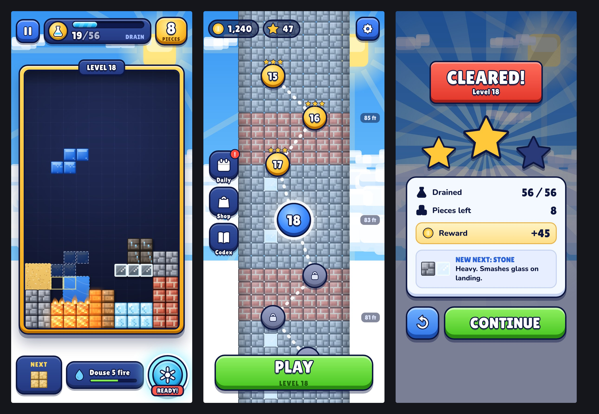
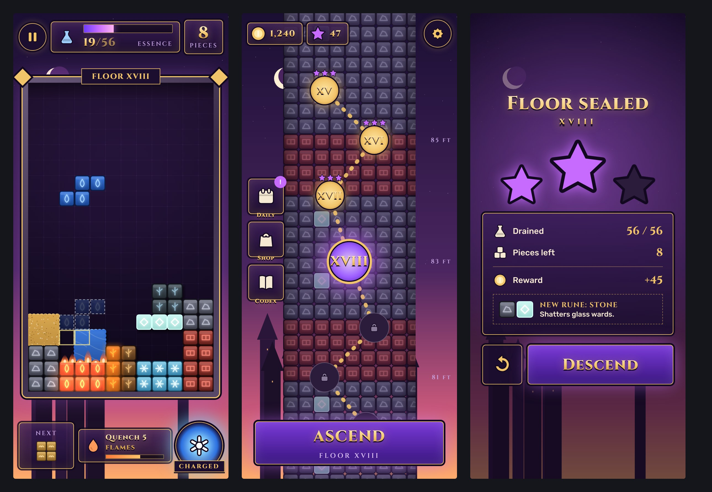
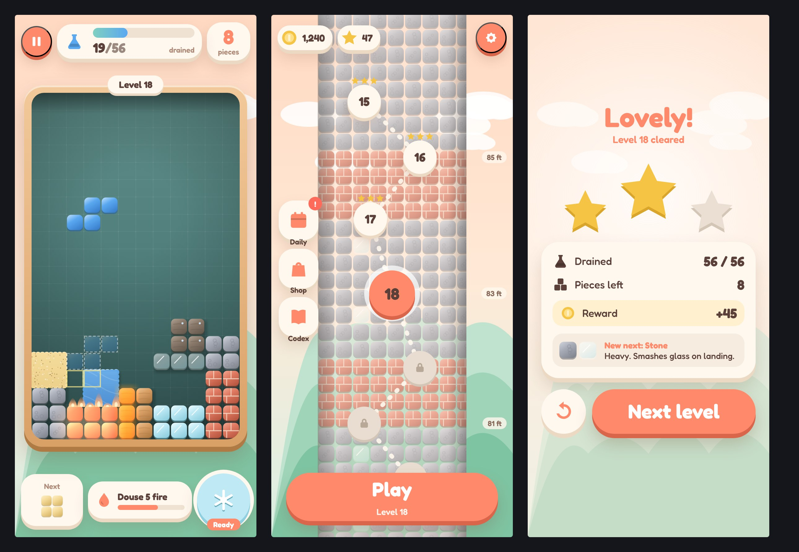

# Three directions

All three are rendered by the real board renderer (`src/render/board.js`) from a real game state (`SHOWCASE.busy`), with real fonts, icons and world backdrops. They aren't paintings. Open `directions/mockup.html?dir=toybox|arcana|clay` with `npm start` to see them live (the fire animates).

The screen layout is the same across all three. That's a UX decision (§6.1 of the prompt): the board as the hero in a framed well, the goal and pieces as the only numbers at the top, next, quest and power in thumb reach at the bottom. The directions differ in concept: world and fiction, block construction, type, UI construction, motion and sound.

## A. Toybox: recommended

**Pitch.** Every material is a chunky voxel cube with a pixel-art face (planks, cobbles, bricks, frost) under a glossy candy bevel. The UI is built like a toy: thick ink outlines, lit faces over darker lips, gold and sky blue. You're climbing down a tower made of the same blocks you play with, from above the clouds to the grass.

- **World:** a bright day sky that changes with altitude. A sea of blocky clouds and the sun up top, then cloud layers, a blocky city, treetops and the ground at level 100.
- **Palette:** sky `#2f8ef0 → #dff6ff`. Well `#24305e → #141a38` (darkest and most neutral, so the materials carry the color). UI navy `#23377f / #33509f`, ink `#0d1640`. Gold `#ffc83a / #e8960c` for rewards and the frame, green `#45c41e` for go, red `#e2362a` only for celebration ribbons and alerts.
- **Type:** Lilita One (display: chunky, friendly numerals, survives a thick outline at any size) and Nunito 800–900 (UI: rounded, legible at 12 px).
- **Blocks:** approach A (Canvas 2D with baked tiles). An 8 × 8 texel face per cell, a 1-texel light bevel top and left and shadow bottom and right, a corner gloss, and an ink outline. Loose water, sand and mud are smooth bodies with a bright surface lip. Fire glows and grows flame tongues.
- **UI chrome:** 3D press buttons (lit face, 6–8 px darker lip, 3 px ink outline), navy panels with an inner highlight, gold badges.
- **Motion:** springy and toy-like. Overshoot pop-ins, squash on landing, chunky square debris, gold coin flights.
- **Sound:** bright, woody and glassy. Marimba and glockenspiel plinks, crunchy cube thuds, sparkly rewards.
- **Monetization fit:** the best of the three. Coins, boosters, skins and chests all look natural in a toy world, and the "premium casual" look is what this audience pays for.
- **Risks:** close to the Royal Match house style, so it needs its own signature: the voxel materials, the tower and the altitude sky. A dark well inside a bright world must keep enough contrast with the frame.
- **Perf:** cheapest. Tiles are baked once per size; per frame it's about one `drawImage` per intact cell plus 3 small composites for loose materials.

## B. Arcana

**Pitch.** An alchemist's tower at dusk. Every material is a carved rune tile with a glowing sigil; the UI is dark glass with gold filigree and Cinzel capitals.

- **World:** violet-to-amber dusk, stars, a crescent moon, spire silhouettes.
- **Palette:** `#1a0f33 → #ffad6b` sky, violet panels `#3a1e58`, gold `#f2c46a`, accent violet `#c76bff`.
- **Type:** Cinzel (display, engraved capitals) and Rubik (UI).
- **Blocks:** rune tiles. Material identity comes from the *icon*, which is excellent for color-blind players.
- **UI chrome:** thin gold borders, inner glow, diamond corner ornaments, flat dark buttons.
- **Motion and sound:** slow, magical shimmer; choirs, chimes, low drones.
- **Monetization fit:** good for mid-core ("rune packs"), weaker for mass-market casual.
- **Risks:** **it abstracts the physics away.** "Fire burns wood" is intuitive when the block looks like wood. When it's a brown tile with a branch sigil, the player has to learn a symbol language first. The glow also edges toward the "neon as a substitute for design" reject. Roman numerals are hard to read at a glance.

## C. Clay

**Pitch.** A cozy diorama. Soft matte clay blocks with big round corners sit in a wooden toy box on pastel hills. Fredoka throughout, cream panels with soft shadows, no outlines.

- **World:** peach sky, layered mint hills, soft clouds.
- **Palette:** peach `#ffd9c2`, mint `#7fc4a2`, coral `#ff8a6b` for primary actions, cream `#fff8ee` panels, teal well `#5f8f8a`.
- **Type:** Fredoka 600–700 for everything.
- **Blocks:** smooth gradients with a soft motif per material (wood grain, mortar lines, pebbles). Very calm and very pretty.
- **UI chrome:** pill buttons with soft drop lips, no strokes.
- **Motion and sound:** gentle, bouncy, soft; felt-mallet sounds.
- **Monetization fit:** fine for a relaxing puzzle, weaker on "excitement" moments (combos, powers, wins).
- **Risks:** **pastels reduce material contrast.** Ice, glass and sand sit close in value on the teal well, and fire loses its heat. Low energy for a game built on reactions and combos.

## Scores (rubric from AUDIT.md, 1–10 against the reference games)

| | 1s | Type | Col | Bg | Blk | Lay | HUD | Val | Mon | Material readability | Fit to the brief |
|---|---|---|---|---|---|---|---|---|---|---|---|
| **A. Toybox** | **9** | **8** | **8** | **8** | **9** | **8** | **8** | **9** | **9** | **9** | **9** (2D but 3D, pixelly like Minecraft, Candy Crush polish) |
| B. Arcana | 7 | 7 | 7 | 7 | 7 | 8 | 7 | 7 | 7 | 7 | 5 (3D tiles, but not Minecraft materials) |
| C. Clay | 8 | 7 | 7 | 7 | 7 | 8 | 7 | 8 | 7 | 6 | 6 (3D and cute, but not pixel) |

(The prototype averaged 2.6 on the same rubric.)

## Recommendation: A, Toybox

It's the only direction that hits every word of the owner's brief: *2D but also 3D*, *pixelly like Minecraft*, *Candy Crush polish*, *feels like it makes money*. It also keeps the materials the most physical, so "fire burns wood" stays self-explanatory. Arcana's color-blind strength (icons on every tile) survives as an **assist mode** in Toybox: a settings toggle that stamps the material icon onto each face. Clay's softness informs the world backdrop: rounded clouds and gentle hills, not harsh pixels.
